# Internet and Computer Networking Notes

## 1. What is the Internet?

The **Internet** is a global network of interconnected computer networks
that communicate using the Internet Protocol (IP) and the TCP/IP
protocol suite.

It allows devices around the world to exchange information and
communicate.

### Types of connections

-   **Wired:** Optical-fibre cables, coaxial cables and Ethernet cables.
-   **Wireless:** Wi-Fi, Bluetooth, cellular technologies such as 3G,
    4G, LTE and 5G.

A wireless connection may be used between a device and an access point
or cellular tower. The connection may then continue through wired
infrastructure.

### Example: Devices connected to a Wi-Fi access point

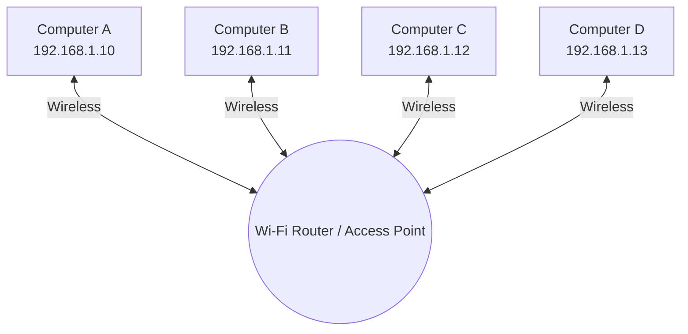

## 2. Data Transfer Speed

Data transfer speed describes how quickly data is transmitted over a
network. It is commonly measured in bits per second (bps).

-   **1 Kbps** = 1,000 bits per second
-   **1 Mbps** = 1,000,000 bits per second
-   **1 Gbps** = 1,000,000,000 bits per second

> Note: File size is usually measured in bytes (B), KB, MB or GB.
> Network speed is usually measured in bits per second (bps).

## 3. Types of Networks

### LAN -- Local Area Network

A **Local Area Network (LAN)** connects devices within a limited
geographical area, such as a home, office, school or building.

Examples: Ethernet LAN and a home or office Wi-Fi network.

### MAN -- Metropolitan Area Network

A **Metropolitan Area Network (MAN)** connects networks across a city or
a large metropolitan area.

Examples: A city-wide network operated using fibre-optic links or
wireless links.

### WAN -- Wide Area Network

A **Wide Area Network (WAN)** connects networks across large
geographical areas, such as countries or continents.

Examples: The Internet and enterprise networks connecting offices in
different cities or countries.

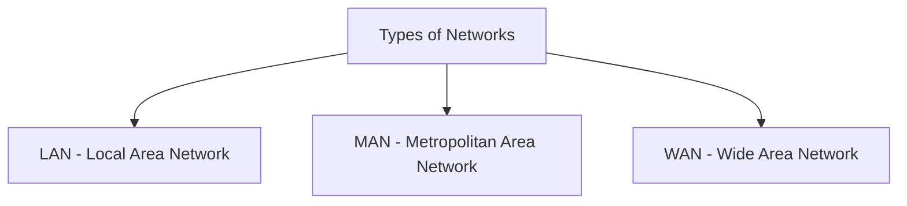

## 4. What is a Computer?

A **computer** is an electronic device that accepts data as input,
processes it according to instructions, stores data and produces
information as output.

> Note: The commonly circulated expansion "Commonly Operated Machine
> Particularly Used for Trade, Education and Research" is not the actual
> origin or standard definition of the word computer.

## 5. IP Address

An **IP address** is a logical address used to identify a network
interface and enable communication over an IP network.

-   A public IP address is globally routable.
-   Private IP addresses are used within private networks and can be
    reused in different private networks.
-   An IPv4 address contains 32 bits, usually written as four decimal
    octets.

### Example: Router connecting devices

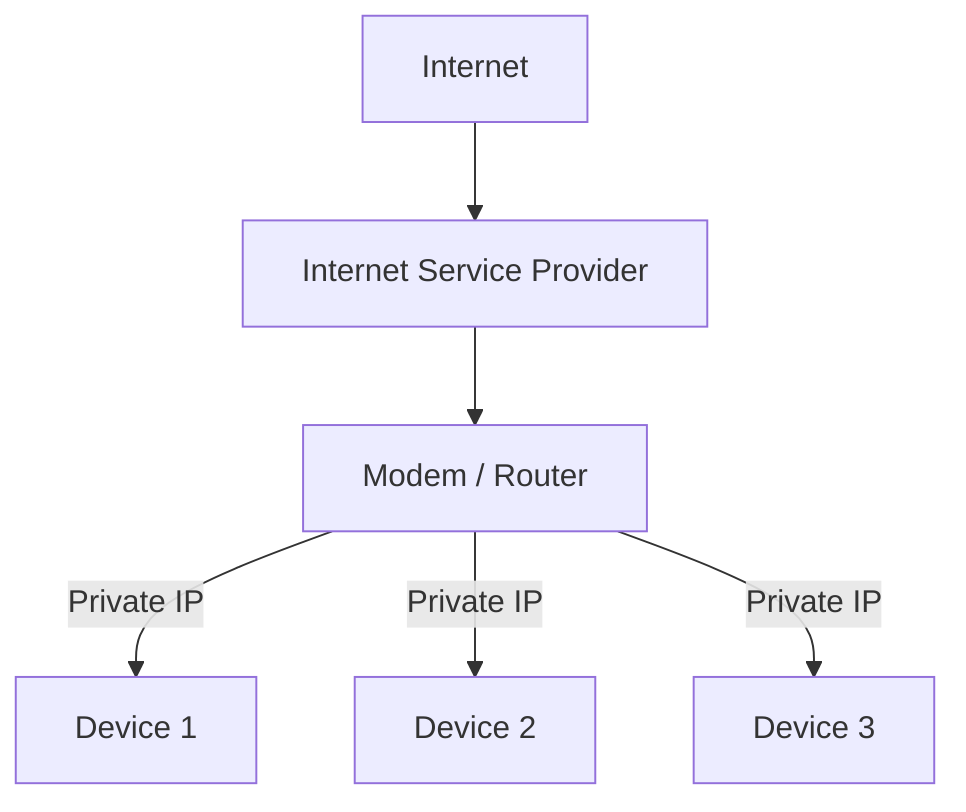

> Note: A modem and a router are different functions, although many home
> devices combine them in one unit.

## 6. IP Address -- Network ID and Host ID

An IPv4 address contains four octets (32 bits). The subnet mask
determines which bits identify the network and which bits identify a
host within that network.

### Example

Consider:

`192.168.2.30/24`

The `/24` prefix means the first 24 bits are the network portion.

-   IP address: `192.168.2.30`
-   Subnet mask: `255.255.255.0`
-   Network ID: `192.168.2.0/24`
-   Host portion (in dotted-decimal form): `0.0.0.30`
-   Host number within this subnet: `30`

### Network ID

**Network ID** identifies the IP network to which an address belongs.

### Host ID

**Host ID** identifies a particular interface or device within that
network.

### Network address

The **network address** identifies the subnet itself. In this example,
it is `192.168.2.0`.

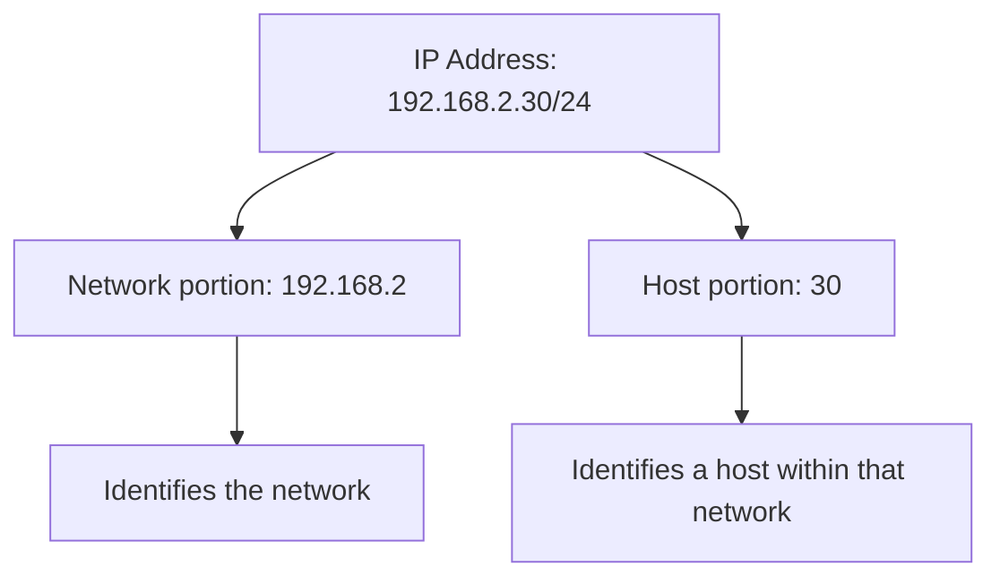

### Important points

-   An IPv4 address contains 4 octets (32 bits).
-   The subnet mask or prefix length determines the network and host
    portions.
-   The division is not always the first three octets; it depends on the
    subnet mask.
-   The example above assumes a `/24` subnet.

## 7. Control Plane

### Definition

The **control plane** is the part of a network device responsible for
making network decisions, such as selecting routes and maintaining
routing information.

In simple words:

**Control Plane = Decides where packets should go.**

### Functions

-   Learns network reachability information.
-   Determines the best routes to destinations.
-   Creates and maintains the routing table.
-   Exchanges routing information with other routers.
-   Uses routing protocols such as OSPF, RIP and BGP.
-   Updates routing information when network topology changes.

### How it works

1.  The control plane receives or learns routing information.
2.  It evaluates available routes.
3.  It selects the best route according to the routing protocol or
    configured route preferences.
4.  It updates the routing table.
5.  The router uses the selected route information to build or update
    its forwarding information.

### Control plane and data plane

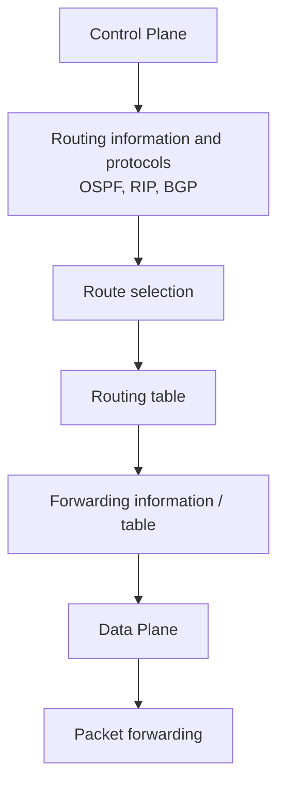

### Difference between Control Plane and Data Plane

  -----------------------------------------------------------------------
  Control Plane                       Data Plane
  ----------------------------------- -----------------------------------
  Makes network and routing           Forwards packets.
  decisions.                          

  Selects routes and maintains        Uses forwarding entries to send
  routing information.                packets to the next hop.

  Uses routing protocols.             Performs packet forwarding.

  Builds or updates forwarding        Applies forwarding information to
  information.                        incoming packets.
  -----------------------------------------------------------------------

### Easy way to remember

-   **Control Plane:** Where should the packet go?
-   **Data Plane:** Forward the packet there.

## 8. Modem

**Modem** stands for **Modulator-Demodulator**.

A modem converts signals between forms suitable for transmission over a
particular communication medium and forms usable by the connected
device. The exact signal conversion depends on the access technology.

## 9. Router

A **router** is a networking device that connects different IP networks
and forwards packets between them using routing and forwarding
information.

-   A router operates primarily at the Network Layer (Layer 3) of the
    OSI model.
-   It examines the destination IP address and forwards packets toward
    the next hop or destination network.

## 10. Routing Table and Forwarding Table

### Routing table

A **routing table** contains route information that a router uses to
determine how to reach destination networks.

It may contain:

-   Destination network or prefix
-   Next hop
-   Outgoing interface
-   Route metric or preference
-   Route source

### Forwarding table

A **forwarding table** contains the information a router uses to forward
packets, typically by matching the destination IP address to a
forwarding entry and selecting an outgoing interface or next hop.

### Difference

  -----------------------------------------------------------------------
  Routing Table                       Forwarding Table
  ----------------------------------- -----------------------------------
  Holds routing information used to   Holds entries used to forward
  select routes.                      packets.

  Supports route calculation and      Supports packet forwarding.
  route selection.                    

  May contain information used by     Is optimized for forwarding
  routing protocols and route         lookups.
  management.                         

  Helps determine which routes should Tells the router where to send a
  be installed for forwarding.        packet next.
  -----------------------------------------------------------------------

### Hop-by-hop forwarding

**Hop-by-hop forwarding** is the process in which each router
independently examines a packet and forwards it to the next hop until it
reaches its destination network.

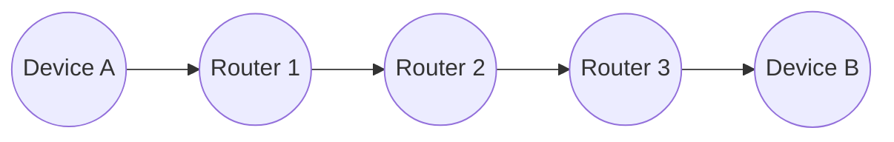

At each router, the forwarding decision is made using that router's
forwarding information.

## 11. Static Routing vs Dynamic Routing

### Static routing

**Definition:** Static routing is a routing method in which a network
administrator manually configures routes on a router.

#### Features

-   Routes are manually configured.
-   Routes do not automatically adapt to topology changes.
-   Does not require a dynamic routing protocol to learn the configured
    route.
-   Often suitable for small or stable networks and specific routes.
-   Requires manual changes when the network topology changes.
-   Usually uses fewer resources than running a dynamic routing
    protocol.

#### Example

An administrator configures Router A to reach Network B through Router
C.

### Dynamic routing

**Definition:** Dynamic routing is a routing method in which routers
learn and update routes automatically by exchanging information using
routing protocols.

#### Features

-   Routers learn routes through routing protocols.
-   Routes can change when network conditions or topology change.
-   Uses routing protocols such as OSPF, RIP and BGP.
-   Often useful in medium and large networks.
-   Can adapt to a link or router failure if an alternative route is
    available.
-   Uses processing, memory and network resources to exchange and
    process routing information.

#### Example

If a path fails, a dynamic routing protocol may calculate and install an
alternative route, provided another usable path exists.

### Difference between Static Routing and Dynamic Routing

  -----------------------------------------------------------------------
  Static Routing                      Dynamic Routing
  ----------------------------------- -----------------------------------
  Routes are manually configured.     Routes are learned using routing
                                      protocols.

  Does not automatically adapt to     Can adapt to topology changes.
  topology changes.                   

  Does not need a dynamic routing     Uses dynamic routing protocols.
  protocol for the manually           
  configured route.                   

  Often useful in small or stable     Often useful in medium and large
  networks.                           networks.

  Route changes require manual        Routes can be recalculated
  configuration.                      automatically.

  Usually uses fewer routing          Uses resources for routing protocol
  resources.                          operation.
  -----------------------------------------------------------------------

### Static routing diagram

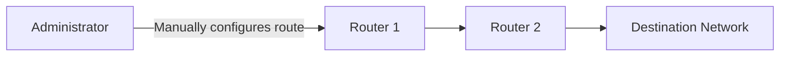

### Dynamic routing diagram

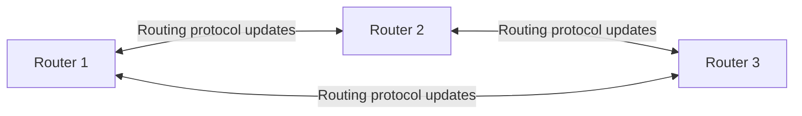

### Examples of dynamic routing protocols

-   **RIP:** Routing Information Protocol.
-   **OSPF:** Open Shortest Path First.
-   **BGP:** Border Gateway Protocol.
-   **EIGRP:** Enhanced Interior Gateway Routing Protocol.

### Easy way to remember

-   **Static = Manually configured**
-   **Dynamic = Learned and updated using routing protocols**

## 12. Gateway

A **gateway** is a device or system that connects networks and allows
communication between them. It can also translate between different
protocols or network systems.

A **default gateway** is the next-hop router or device that a host sends
traffic to when the destination is outside its local network.

## 13. Port Numbers

An IP address identifies a network interface or device for IP
communication. A **port number** identifies an application endpoint or
service on a device.

-   Port numbers are 16-bit numbers.
-   The range is 0 to 65,535.
-   Total possible port numbers: `2^16 = 65,536`.

### Port number ranges

-   **0--1023:** Well-known ports.
-   **1024--49151:** Registered ports.
-   **49152--65535:** Dynamic/private ports.

### Common examples

  Port    Common service
  ------- ------------------
  20/21   FTP data/control
  22      SSH
  25      SMTP
  53      DNS
  80      HTTP
  443     HTTPS

> Note: These are common default port assignments. A service can
> sometimes be configured to use a different port.

## 14. Ephemeral Ports

An **ephemeral port** is a temporary port number that an operating
system typically assigns to the local side of a communication session.

-   Ephemeral ports are commonly used by client applications when
    initiating connections.
-   They help distinguish different communication sessions.
-   They are not exclusively used on the client side; temporary ports
    can also be used by other applications and services.

## 15. Data Centre

A **data centre** is a physical facility that contains servers, storage
systems, networking equipment, power systems and cooling infrastructure.

It provides computing, storage and networking services to organizations
and users.

## 16. Network Sockets

A **network socket** is an endpoint used by an application to send and
receive data over a network.

A socket is commonly associated with:

-   IP address
-   Port number
-   Transport protocol (such as TCP or UDP)

In simple words:

**A socket is an interface through which an application communicates
over a network.**

## 17. Peer-to-Peer (P2P) Architecture

**Definition:** Peer-to-peer architecture is a network architecture in
which each participating computer (peer) can act as both a client and a
server, sharing resources directly with other peers.

### Features

-   Peers can share resources directly.
-   A peer can request and provide services.
-   There may be no central server responsible for all communication.
-   Peers can join or leave the network.

### Mermaid diagram

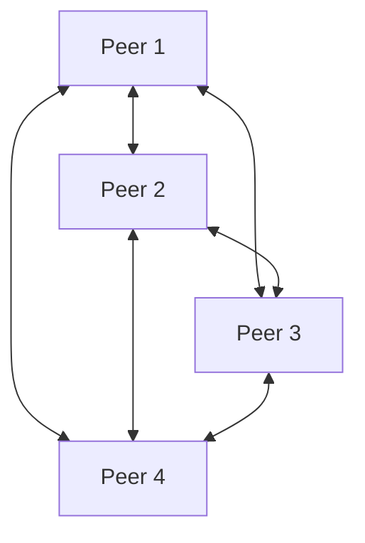
# 18 Middleboxes in Computer Networks

## 1. Firewall

A **Firewall** is a middlebox that monitors and filters network packets based on predefined security rules.

### Working of Firewall

- Acts as a barrier between the Global Internet and your trusted network.
- Filters incoming and outgoing IP packets.
- Allows or blocks packets based on various rules.

### Filtering Rules

- IP Addresses
- Port Numbers
- Flags
- Protocols
- Packet information

### Firewall Diagram

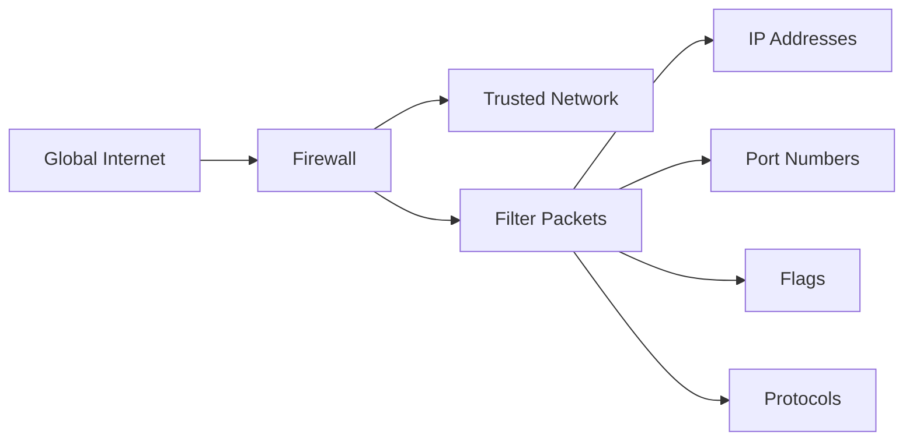

### Important Points

- Firewall provides network security.
- Prevents unauthorized access.
- Filters packets based on predefined rules.
- Can allow or block network traffic.

## 19. How NAT Works – Packet Address Translation

NAT changes the source or destination IP address of packets when they pass through a NAT router.

### Example Network

| Device | IP Address |
|---|---|
| Host (Private IP) | `10.0.0.1` |
| NAT Router (Public IP) | `150.150.0.1` |
| Server | `200.100.10.1` |

### 1. Outgoing Packet (Host → Server)

- Host sends a packet to the server.
- Source IP = `10.0.0.1`
- Destination IP = `200.100.10.1`
- NAT router changes the source IP to its public IP.

| Before NAT | After NAT |
|---|---|
| Source: `10.0.0.1` | Source: `150.150.0.1` |
| Destination: `200.100.10.1` | Destination: `200.100.10.1` |

### 2. Incoming Packet (Server → Host)

- Server sends a response packet.
- Destination IP = `150.150.0.1`
- NAT router identifies the corresponding internal device using its translation table.
- Changes the destination IP back to `10.0.0.1`.

| Before NAT | After NAT |
|---|---|
| Source: `200.100.10.1` | Source: `200.100.10.1` |
| Destination: `150.150.0.1` | Destination: `10.0.0.1` |

### 3. NAT Working Diagram

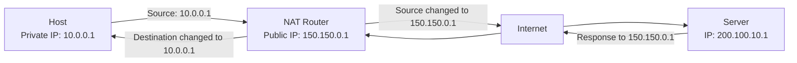

### 4. Important Points

- NAT modifies IP addresses in packet headers.
- Outgoing packets: Private IP → Public IP.
- Incoming packets: Public IP → Private IP.
- NAT router maintains a translation table to identify internal devices.
- In PAT, port numbers are also used to distinguish connections.

**Remember:** NAT allows private network devices to communicate with the Internet using a public IP address.

## 20. Quick Revision

  -----------------------------------------------------------------------
  Term                                Remember
  ----------------------------------- -----------------------------------
  Internet                            Global network of interconnected
                                      networks

  IP address                          Identifies a network interface for
                                      IP communication

  Network ID                          Identifies the network

  Host ID                             Identifies a host within a network

  Control Plane                       Makes network and routing decisions

  Data Plane                          Forwards packets

  Modem                               Modulates and demodulates signals

  Router                              Connects IP networks and forwards
                                      packets

  Routing table                       Stores route information

  Forwarding table                    Used to forward packets

  Static routing                      Manually configured routes

  Dynamic routing                     Routes learned using routing
                                      protocols

  Gateway                             Connects networks; default gateway
                                      is the next hop for off-network
                                      traffic

  Port number                         Identifies an application endpoint
                                      or service

  Ephemeral port                      Temporary port used for a
                                      communication session

  Data centre                         Facility containing computing and
                                      network infrastructure

  Socket                              Application communication endpoint

  Peer-to-peer                        Peers can act as both clients and servers

  
  -----------------------------------------------------------------------
