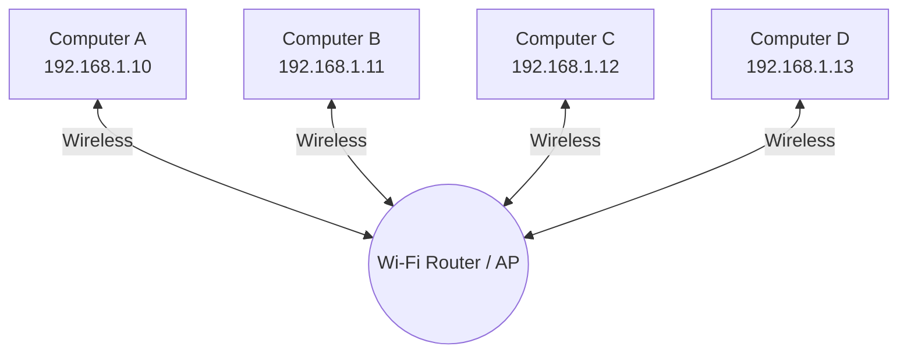
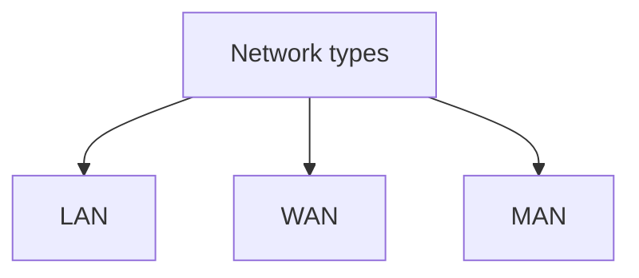
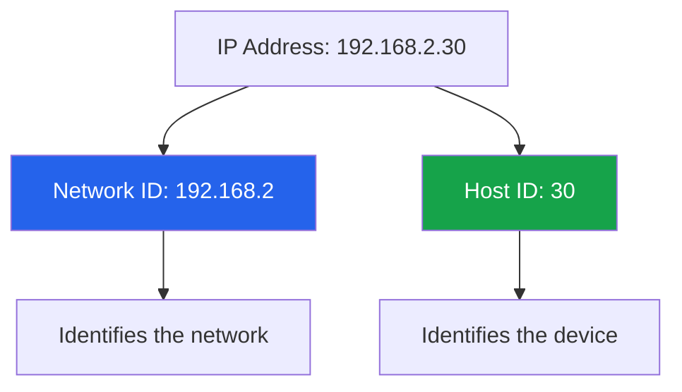
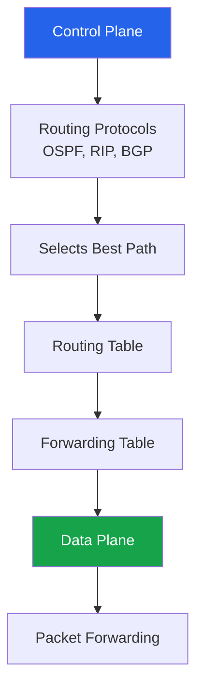
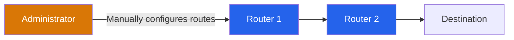
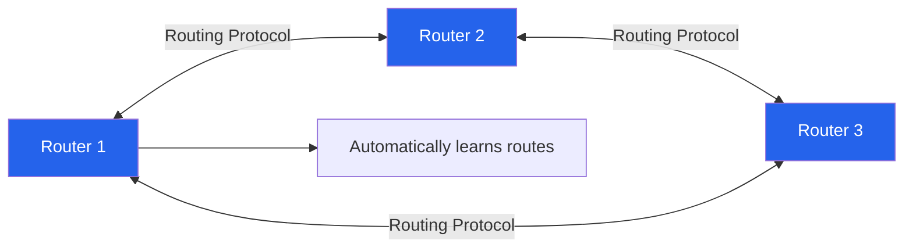
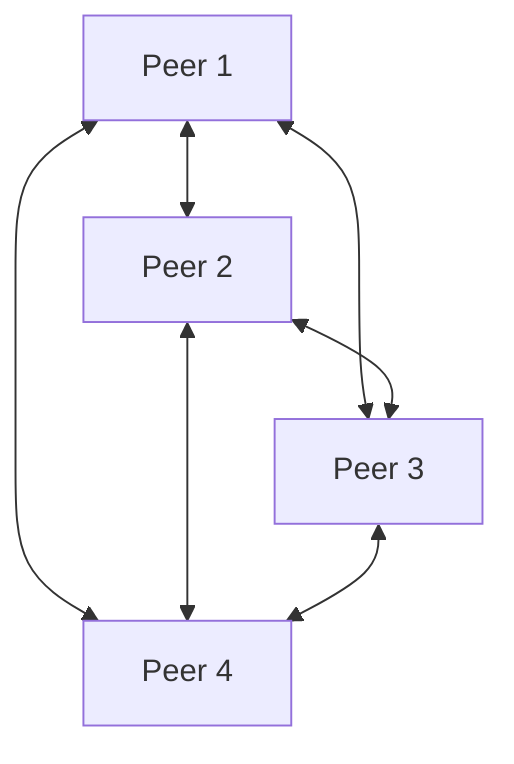

# Internet 

## What is Internet ?

Internet is a collection of  computers interconnected to each other for sharing data on global stage via IP addresses. It connects different countries or places in two ways which are,
* Physically : using Optical fibre cables and coaxil cables
* Wireless: bluetooth,wifi,3G,4G,5G,LTE can used for short range (Until reaching the tower, it's wireless; after the tower, it's wired) 




### file sizes
  It defines the speed of uploading and downloading files in computers

* 1 Kbps :1000 bits/s
* 1 Mbps : 1000,000  bits/s
* 1 Gbps :10^9 bits/s

### Types of network

* LAN: Local area Network (For small house or office)
eg:Wifi,Ethernet
* WAN: Wide area Network (Across countries)
eg:Optical fibre cables,SONET,Frame relay connects local area network with wide area network
* MAN: Metropolitan Area Network (Across the city)
eg:Optical fibre cables,Wireless network 




## Define Computer ?

COMPUTER : Commonly Oriented Meachine Particularly For Training Education And Research

# IP Address ?

An IP Address is a unique id assigned to each device connected to the computer network which used Internet Protocol for communication.

   ```mermaid
flowchart TD
    A[ISP Internet service provider] -->|WIFI Connection| B(Modem/Router)
    
    B-->|Local IP 1| D[Device 1]
    B -->|Local IP 2| E[Device 2]
    B -->|Local IP 3| F[Device 3]
   ```
# IP Address – Network ID and Host ID

## 1. Example

Consider the IP address:

`192.168.2.30`

An IPv4 address contains 4 octets.

- `192.168.2` → Network ID
- `30` → Host ID

**Note:** This division assumes the default Class C subnet mask (`255.255.255.0` or `/24`).

## 2. Network ID

**Definition:** Network ID identifies the network to which a device belongs.

## 3. Host ID

**Definition:** Host ID identifies a particular device within a network.

## 4. Network Address

The network address identifies the entire network.

For example:

- IP Address: `192.168.2.30`
- Subnet Mask: `255.255.255.0`
- Network Address: `192.168.2.0`
- Host ID: `30`

## 5. Mermaid Diagram



## 6. Important Points

- Network ID identifies the network.
- Host ID identifies the device within that network.
- An IP address consists of 4 octets (32 bits).
- The subnet mask determines which bits represent the network and which represent the host.

# Control Plane (Computer Networks)

## 1. Definition

**Control Plane** is the part of a network device (router) responsible for making routing decisions and determining the best path for data to reach its destination.

In simple words:

**Control Plane = Decides where the data should go.**

## 2. Functions of Control Plane

- Determines the best path to reach a destination.
- Creates and maintains the routing table.
- Exchanges routing information with other routers.
- Uses routing protocols such as OSPF, RIP and BGP.
- Updates routing information when network topology changes.

## 3. How It Works

1. The control plane receives routing information.
2. It analyzes the available paths.
3. It selects the best path.
4. It builds or updates the routing table.
5. It provides forwarding information to the data plane.

## 4. Mermaid Diagram



## 5. Difference Between Control Plane and Data Plane

| Control Plane | Data Plane |
|---|---|
| Makes routing decisions. | Forwards packets. |
| Finds the best path. | Sends packets to the next hop. |
| Creates routing information. | Uses forwarding table entries. |
| Uses routing protocols. | Performs packet forwarding. |
| Also called the brain of the router. | Also called the forwarding plane. |

## 6. Important Points to Remember

- Control Plane = Decision making.
- Data Plane = Packet forwarding.
- Control Plane determines the best path.
- Data Plane forwards packets using the forwarding table.
- Routing protocols work in the Control Plane.

### Easy Trick to Remember

- **Control Plane** → Where should the data go?
- **Data Plane** → Send the data there.

### Modem

Modem is used to convert digital signals into analog signals and vice versa 

### Router

Router is a device that redirects the packets to its designated IP Adresses and it is in network layer

# Static Routing vs Dynamic Routing

## 1. Static Routing

**Definition:** Static routing is a routing method in which the network administrator manually configures the routes in the router's routing table.

### Features
- Routes are manually configured by the administrator.
- Routes do not change automatically.
- Does not require routing protocols.
- Suitable for small networks.
- Requires manual updates when network topology changes.
- Uses fewer router resources.

### Example
An administrator manually tells Router A to send packets to Network B through Router C.

## 2. Dynamic Routing

**Definition:** Dynamic routing is a routing method in which routers automatically learn and update routes using routing protocols.

### Features
- Routes are learned automatically.
- Routes can change based on network conditions.
- Uses routing protocols such as OSPF, RIP and BGP.
- Suitable for medium and large networks.
- Automatically adapts to network topology changes.
- Requires more router resources.

### Example
If one network path fails, the router can automatically find an alternative path using routing information.

## 3. Difference Between Static Routing and Dynamic Routing

| Static Routing | Dynamic Routing |
|---|---|
| Routes are manually configured. | Routes are learned automatically. |
| Does not change automatically. | Updates routes automatically. |
| Does not require routing protocols. | Uses routing protocols. |
| Suitable for small networks. | Suitable for medium and large networks. |
| Requires manual maintenance. | Requires less manual route maintenance. |
| Uses fewer resources. | Uses more resources. |
| Does not automatically adapt to network failures. | Can adapt to network failures if an alternative route is available. |

## 4. Mermaid Diagram

### Static Routing



### Dynamic Routing



## 5. Examples of Routing Protocols

- **RIP:** Routing Information Protocol.
- **OSPF:** Open Shortest Path First.
- **BGP:** Border Gateway Protocol.
- **EIGRP:** Enhanced Interior Gateway Routing Protocol.

## 6. Important Points to Remember

- Static Routing = Manually configured routes.
- Dynamic Routing = Automatically learned routes.
- Static Routing is suitable for small networks.
- Dynamic Routing is suitable for large networks.
- OSPF, RIP and BGP are examples of dynamic routing protocols.

### Easy Trick to Remember

**Static = Manual**

**Dynamic = Automatic**

### Gateway

A passage to connect two networks together is called gateway that may work on two different network model

## Port number

An IP adress is used to find the location of the device ,Meanwhile port number is used to find the which application in the device you are using. Ports are 16 bit numbers which is 2^16

* Ports 0 to 1023 :reserved ports
* Ports 1024 to 49152 : Reserved for specific applications
* remaining ports:for our use

### Ephermal Ports

An ephemeral port is a temporary port automatically assigned by a device's operating system to handle outbound client requests, acting as a temporary "return address.Instead of being triggered by multiple processes crowding a single port, ephemeral ports are used every time a client initiates a connection."It exist only in the client side not on the server side


## Data Centre

Collection of servers with static IP addresses and high upload and download speed is called data centre

## Sockets

A network socket is an endpoint that lets two applications send and receive data across a computer network. It is just a interface between process and the internet

## Peer to Peer Architecture

A Network in which each computer behaves as both client and server is called peer to peer architecture


