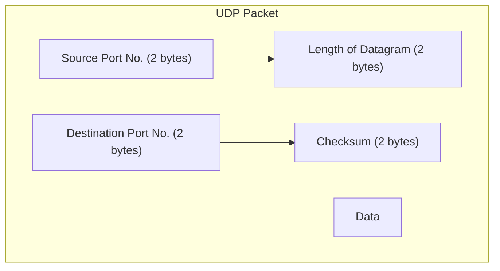

# UDP

UDP stands for User Datagram Protocol. It is a transport layer protocol used for sending data between devices over a network.It is a connectionless protocol. It uses checksum 

## Disadvantages of UDP

* In UDP data may or maynot be delivered.
* Data maybe change
* Data may not be in order
