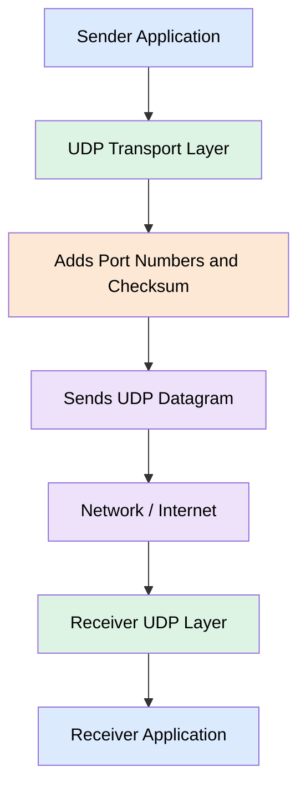

# UDP

UDP stands for User Datagram Protocol. It is a Transport Layer
protocol used for sending data between devices over a network.
- It is a connectionless protocol.
- It uses source and destination port numbers.
- It uses a checksum to detect possible data corruption.
- It does not guarantee data delivery.

## Disadvantages of UDP

* Data may or may not be delivered: UDP does not guarantee that
* data reaches the receiver.
* Data may be corrupted: Data can be damaged during transmission.
* The UDP checksum helps detect possible corruption.
* Data may not arrive in order: Datagrams may reach the receiver
* in a different order from the order in which they were sent.

## Advantages of UDP

* Faster communication: UDP does not establish a connection before sending data.
* Low overhead: The UDP header is 8 bytes, which is smaller than TCP's minimum 20-byte header.
* No waiting for acknowledgements: UDP does not require acknowledgements at the UDP protocol level.

## Real-Life Examples
- Online gaming
- Video calls
- Live streaming
- DNS queries

## Easy Way to Remember
- TCP = Reliability
- UDP = Speed
