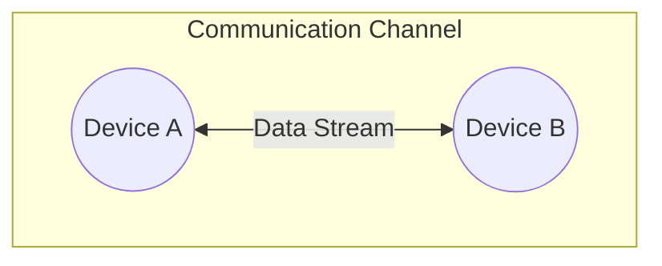

# TCP (Transmission Control Protocol)

## 1. Introduction

- TCP stands for **Transmission Control Protocol**.
- It is a Transport Layer protocol.
- It provides reliable communication between two devices over a network.
- When the application layer sends a large amount of data, TCP divides the data into smaller pieces called **segments**.
- TCP adds headers to each segment containing important information.
- These segments are passed to the Network Layer.
- At the receiving end, TCP reassembles the segments into the original data.

## 2. What Does TCP Take Care Of?

1. **Delivery:** Checks whether data has reached the destination.
2. **Ordering:** Maintains the correct order of data.
3. **Error Control:** Detects lost or corrupted segments and retransmits data when necessary.
4. **Flow Control:** Prevents the sender from overwhelming the receiver.
5. **Congestion Control:** Controls the sending rate to avoid overloading the network.

## 3. Features of TCP

- **Connection-oriented:** Establishes a connection before transmitting data.
- **Reliable:** Ensures data is delivered correctly using acknowledgements and retransmissions.
- **Error Control:** Detects errors and handles lost or corrupted data.
- **Flow Control:** Controls the speed of data transmission based on receiver capacity.
- **Congestion Control:** Controls transmission to reduce network congestion.
- **Full Duplex:** Both devices can send and receive data simultaneously.
- **Ordered Delivery:** Delivers data to the application in the correct order.

## 4. Full Duplex Communication

Full duplex means both devices can send and receive data at the same time.

- Device A can send data to Device B.
- Device B can send data to Device A.
- Both can communicate simultaneously.

## 5. Difference Between Error Control, Flow Control and Congestion Control

| Type | Explanation |
|---|---|
| Error Control | Handles lost or corrupted data. |
| Flow Control | Prevents the receiver from being overloaded. |
| Congestion Control | Prevents the network from being overloaded. |

## 6. Quick Revision (Exam Preparation)

- TCP = Transmission Control Protocol.
- TCP works at the **Transport Layer**.
- TCP is connection-oriented.
- TCP provides reliable data transmission.
- TCP divides data into segments.
- TCP maintains the order of data.
- TCP provides error control, flow control and congestion control.
- TCP supports full-duplex communication.

### Important note

**TCP = Reliable + Connection-oriented + Full-duplex communication.**
**A Header is a piece of extra information added at the beginning of data to help the receiver understand how to handle that data.**

# TCP Network Layer

In TCP Network layer we work with routers. In this layer data is in the form of packets 
