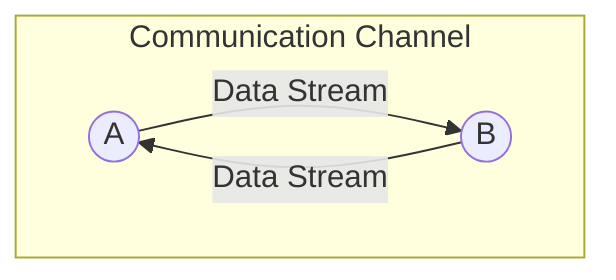

# TCP

* Stands for transmission control protocol
* When we get data from the application layer, It sends a lot of raw data and TCP segments this Data (Divide in chunks , add headers). It may also collect the data from network layer
* It provides conjuction control

## Take care of 
* Wheather data arrived or not
* Maintains the order of the data

## Features
* It is connection oriented
* It also provides error control, Conjuction control
* full duplex (Bi directional)

