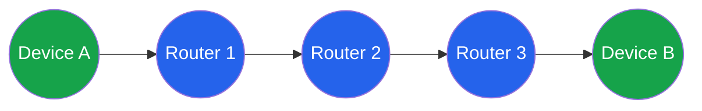

# Routing Table and Forwarding Table

## 1. Routing Table

**Definition:** A routing table is a table maintained by a router that contains information about available network paths and helps determine the best path to reach a destination.

### Functions
- Determines the best path to the destination.
- Contains destination network, next hop, metric and outgoing interface.
- Helps routers make routing decisions.

## 2. Forwarding Table

**Definition:** A forwarding table is a table used by a router to decide where to send an incoming packet based on its destination IP address.

### Functions
- Checks the destination IP address of an incoming packet.
- Determines the next hop or outgoing interface.
- Forwards the packet to the next router.
- Performs packet forwarding at each hop.

## 3. Difference Between Routing Table and Forwarding Table

| Routing Table | Forwarding Table |
|---|---|
| Finds the best path. | Forwards packets to the next hop. |
| Used for routing decisions. | Used for packet forwarding. |
| Contains routing information. | Contains forwarding entries. |
| Helps build the forwarding table. | Uses entries to forward packets. |

## 4. Hop-by-Hop Forwarding

**Definition:** Hop-by-hop forwarding is a process in which each router forwards a packet to the next router based on its forwarding table until the packet reaches the destination.

### How It Works

1. Device A sends a packet to the first router.
2. Router 1 checks the destination IP address.
3. It looks up its forwarding table.
4. It forwards the packet to the next hop (Router 2).
5. Router 2 repeats the same process.
6. This continues until the packet reaches Device B.

### Mermaid Diagram

## 5. Important Points to Remember

- **Routing:** Deciding the best path.
- **Forwarding:** Sending the packet to the next hop.
- **Hop-by-Hop:** Every router forwards the packet to the next router until it reaches the destination.

### Easy Trick to Remember

**Routing = Find the path**

**Forwarding = Send the packet**

**Hop-by-Hop = Router to Router**