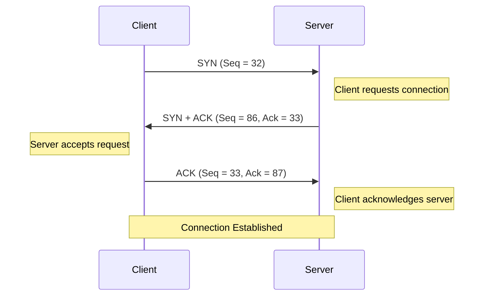

# 3 way Handshake

1. SYN (Synchronize)
- Client sends a connection request to the server.
- It says: "I want to establish a connection with you."
- Client sends its initial sequence number.
2. SYN + ACK (Synchronize + Acknowledgment)
- Server responds to the client.
- SYN means: "I am ready to establish a connection."
- ACK means: "I received your request."
3. ACK (Acknowledgment)
- Client acknowledges the server's response.
- Both sides are now ready to exchange data.

## Explanation
1. SYN: Client sends a connection request to the server with sequence number 32.
2. SYN + ACK: Server responds with its own sequence number 86 and acknowledges the client's sequence number (32 + 1 = 33).
3. ACK: Client acknowledges the server's sequence number (86 + 1 = 87).
## Result
 TCP connection is successfully established.
# Sequence Number
Sequence Number are random numbers for security purposes.

