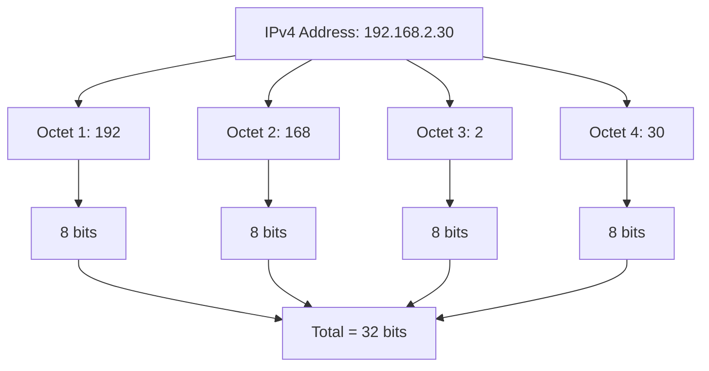
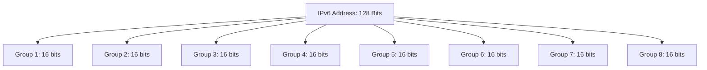
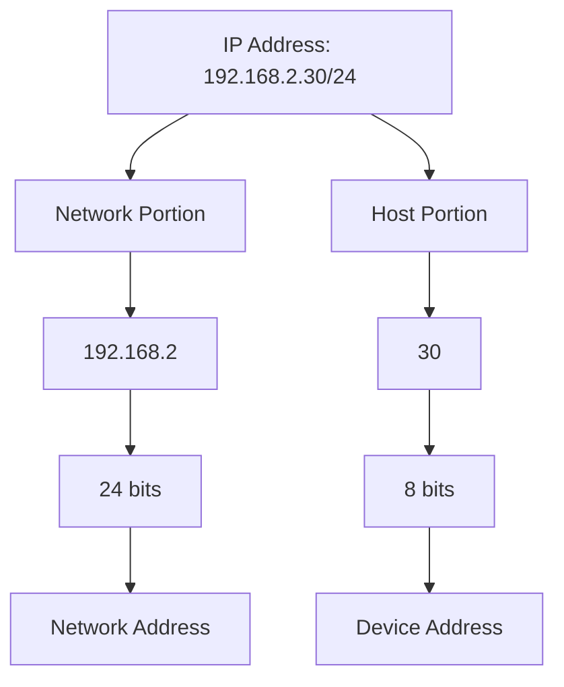
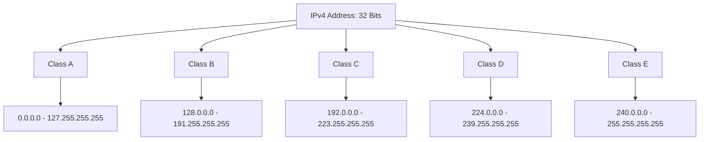
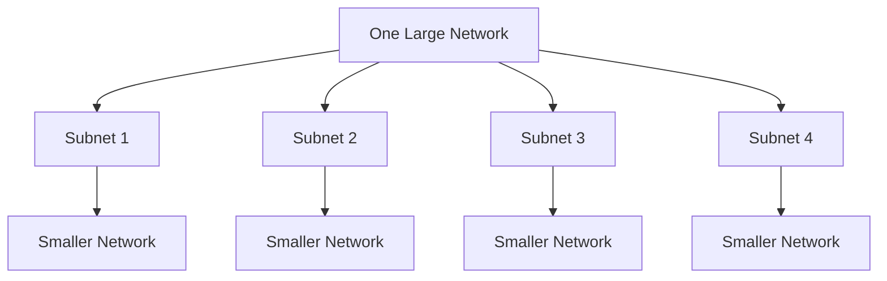
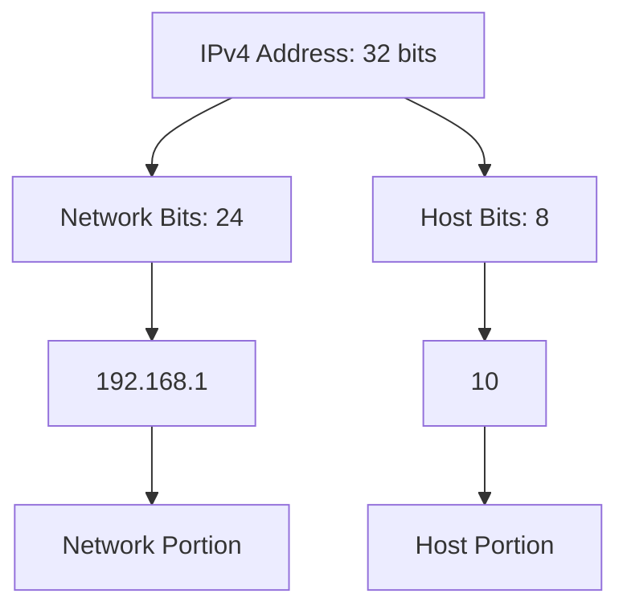
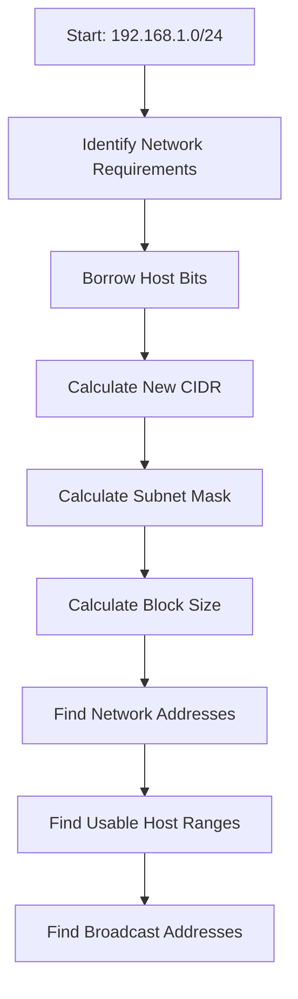
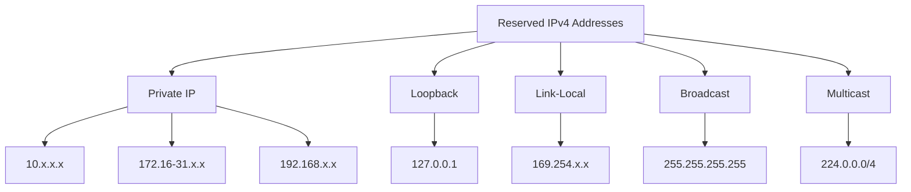

# Internet Protocol (IP)

## 1. IPv4 (Internet Protocol Version 4)

- Uses **32-bit addresses**.
- Total IP addresses = **2³² = 4.3 billion** (approximately).
- Consists of **4 octets**.
- Each octet contains 8 bits.

**Example:**

`192.168.2.30`

### IPv4 Address Structure

## 2. IPv6 (Internet Protocol Version 6)

- Uses **128-bit addresses**.
- It is **4 times wider** than IPv4 in terms of address bits.
- Total IP addresses = **2¹²⁸**.
- Consists of 8 groups of hexadecimal numbers.
- Each group represents 16 bits.

**Example:**

`2001:0db8:85a3:0000:0000:8a2e:0370:7334`

### IPv4 vs IPv6

| Feature | IPv4 | IPv6 |
|---|---|---|
| Address Size | 32 bits | 128 bits |
| Address Format | Decimal | Hexadecimal |
| Number of Groups | 4 octets | 8 groups |
| Total Addresses | 2³² | 2¹²⁸ |

## Advantages and Disadvantages of IPv6

### Disadvantages (Cons)

- **Not Backward Compatible:** IPv6 is not directly backward compatible with IPv4.
- **Migration Cost:** ISPs would have to shift from IPv4 to IPv6.
- **Hardware Changes:** Requires hardware and infrastructure upgrades.

### IPv6 Address Structure

---

# Computer Networking – Network Addressing and Control Plane

## 1. IP Address Structure

**Example:**

`192.168.2.30/24`

An IPv4 address consists of four octets.

| Part | Value | Meaning |
|---|---|---|
| Network portion | 192.168.2 | Network Address |
| Host portion | 30 | Device Address |

### Network and Host Portion Diagram

---

# Classes of IP Addresses (IPv4)

IPv4 addresses are divided into five classes:

- Class A
- Class B
- Class C
- Class D
- Class E

## 1. IP Address Classes and Ranges

| Class | Starting Address | Ending Address |
|---|---|---|
| A | `0.0.0.0` | `127.255.255.255` |
| B | `128.0.0.0` | `191.255.255.255` |
| C | `192.0.0.0` | `223.255.255.255` |
| D | `224.0.0.0` | `239.255.255.255` |
| E | `240.0.0.0` | `255.255.255.255` |

## 2. Diagram – IP Address Classes

## 3. Characteristics of IP Address Classes

| Class | Default Subnet Mask | Purpose |
|---|---|---|
| A | `255.0.0.0` (/8) | Large networks |
| B | `255.255.0.0` (/16) | Medium networks |
| C | `255.255.255.0` (/24) | Small networks |
| D | Not applicable | Multicasting |
| E | Not applicable | Experimental / Reserved |

## 4. First Octet Range

| Class | First Octet Range |
|---|---|
| A | 1–126 (traditional usable range) |
| B | 128–191 |
| C | 192–223 |
| D | 224–239 |
| E | 240–255 |

## 5. Important Points

- IPv4 has 32 bits.
- IPv4 consists of 4 octets.
- Each octet contains 8 bits.
- Classes A, B and C are traditionally used for unicast addressing.
- Class D is used for multicast.
- Class E is reserved for experimental purposes.
- `127.0.0.0/8` is reserved for loopback.

**Note:** Classful addressing is a historical addressing system. Modern networks primarily use CIDR (Classless Inter-Domain Routing).

---

# Subnetting in Computer Networks

## 1. What is Subnetting?

Subnetting is the process of dividing one large network into smaller networks called **subnets**.

### Advantages of Subnetting

- Reduces network traffic.
- Improves network security.
- Uses IP addresses efficiently.
- Makes network management easier.

### Subnetting Diagram

## 2. Understanding an IP Address

**Example:**

`192.168.1.10/24`

| Parameter | Value |
|---|---|
| IP Address | `192.168.1.10` |
| Subnet Mask | `255.255.255.0` |
| Network Bits | 24 |
| Host Bits | 8 |

### Explanation

- `/24` represents 24 network bits.
- Remaining 8 bits represent host bits.
- Total IPv4 address length = 32 bits.

### Subnet Mask Diagram

### Subnetting Process

---
# Reserved IP Addresses (IPv4)

Reserved IP addresses are used for special networking purposes.

## 1. Important Reserved IP Addresses

| IP Address / Range | Purpose |
|---|---|
| `0.0.0.0` | Unspecified address |
| `127.0.0.1` | Loopback (Localhost) |
| `169.254.0.0/16` | Link-Local |
| `255.255.255.255` | Broadcast |
| `224.0.0.0/4` | Multicast |
| `240.0.0.0/4` | Reserved |

## 2. Private IP Address Ranges

| Class | Private IP Range |
|---|---|
| A | `10.0.0.0/8` |
| B | `172.16.0.0/12` |
| C | `192.168.0.0/16` |

## 3. Important Points

- `127.0.0.1` → Localhost.
- `10.x.x.x` → Private Class A.
- `172.16.x.x – 172.31.x.x` → Private Class B.
- `192.168.x.x` → Private Class C.
- `169.254.x.x` → Link-Local.
- `255.255.255.255` → Limited Broadcast.
- `224.0.0.0/4` → Multicast.

## 4. Diagram

