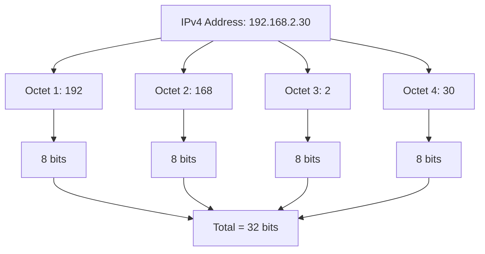
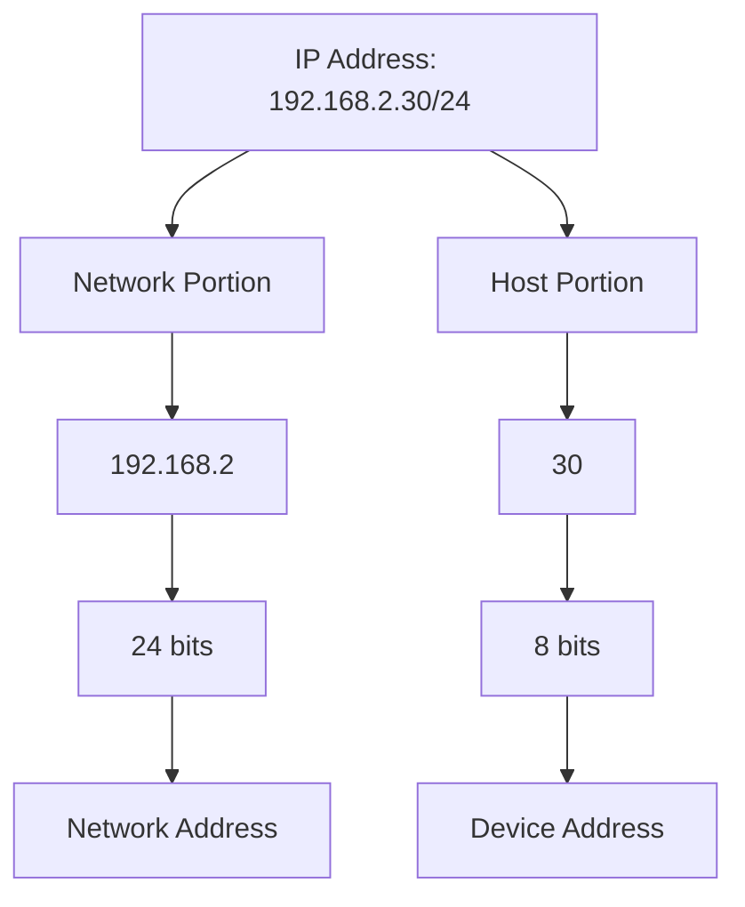
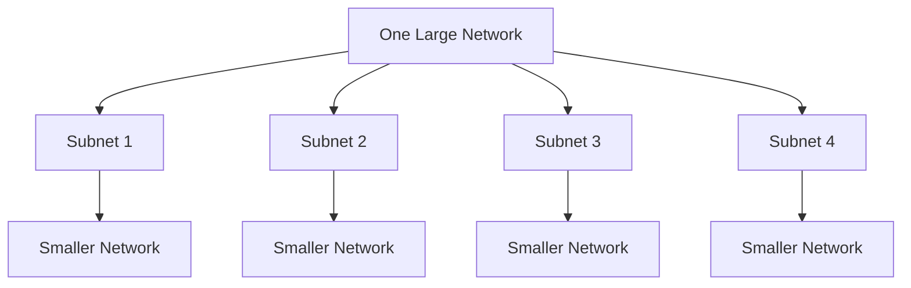
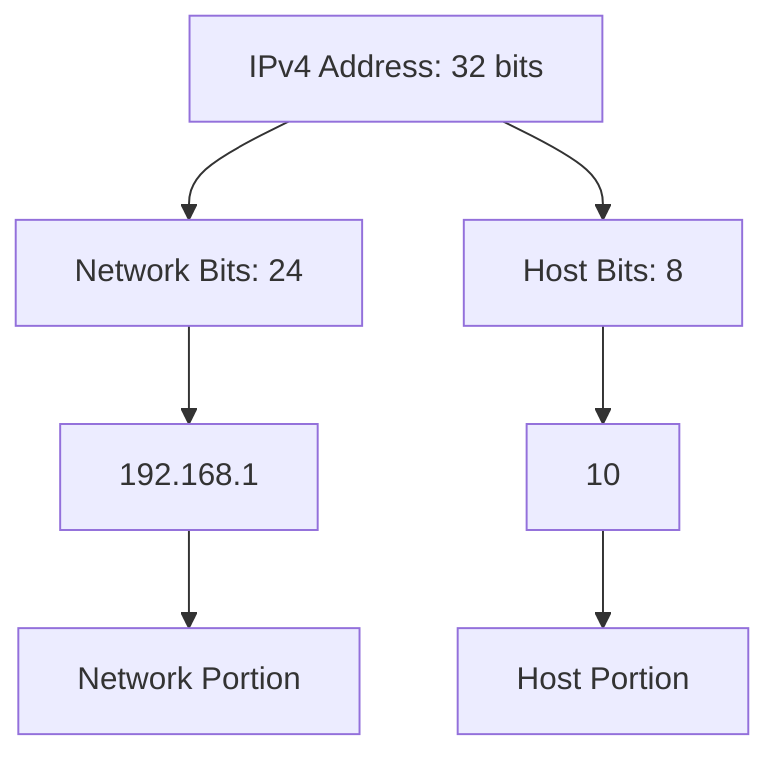
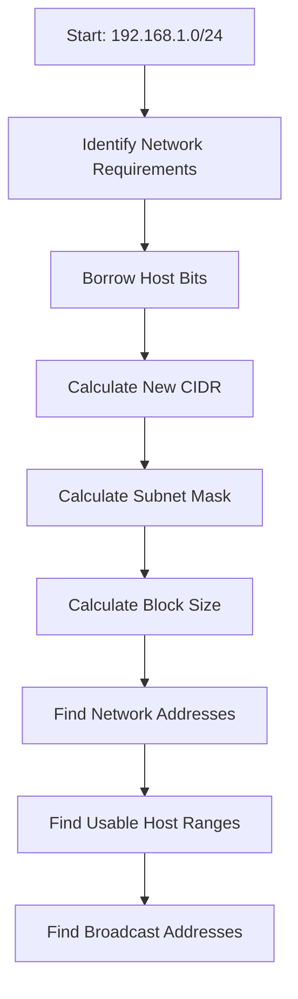

# Internet Protocol (IP)

## 1. IPv4 (Internet Protocol Version 4)

- Uses **32-bit addresses**.
- Consists of **4 octets**.
- Each octet contains 8 bits.

**Example:**

`192.168.2.30`

### IPv4 Address Structure

## 2. IPv6 (Internet Protocol Version 6)

-

---

# Computer Networking – Network Addressing and Control Plane

## 1. IP Address Structure

**Example:**

`192.168.2.30/24`

An IPv4 address consists of four octets.

| Part | Value | Meaning |
|---|---|---|
| Network portion | 192.168.2 | Network Address |
| Host portion | 30 | Device Address |

### Network and Host Portion Diagram

---

# Subnetting in Computer Networks

## 1. What is Subnetting?

Subnetting is the process of dividing one large network into smaller networks called **subnets**.

### Advantages of Subnetting

- Reduces network traffic.
- Improves network security.
- Uses IP addresses efficiently.
- Makes network management easier.

### Subnetting Diagram

## 2. Understanding an IP Address

**Example:**

`192.168.1.10/24`

| Parameter | Value |
|---|---|
| IP Address | `192.168.1.10` |
| Subnet Mask | `255.255.255.0` |
| Network Bits | 24 |
| Host Bits | 8 |

### Explanation

- `/24` represents 24 network bits.
- Remaining 8 bits represent host bits.
- Total IPv4 address length = 32 bits.

### Subnet Mask Diagram

### Subnetting Process

---

**End of Computer Networking Notes**