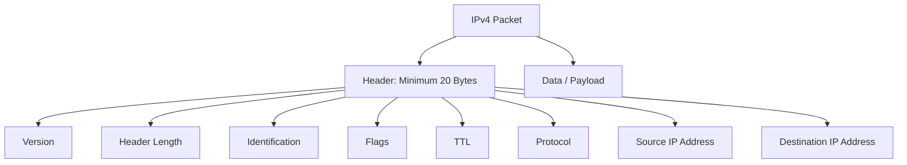
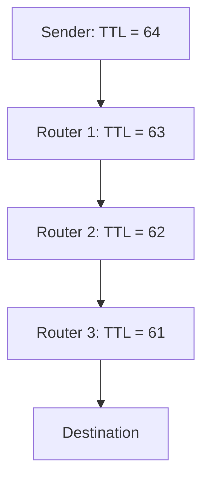

# Packets

- An IPv4 packet header has a **minimum size of 20 bytes**.
- It contains IP Version, Header Length, Identification Number, Flags, TTL, Protocol, Source IP, Destination IP, etc.

## IPv4 Packet Header Structure

---

# TTL (Time To Live) in IP Packets

## 1. What is TTL?

- TTL stands for **Time To Live**.
- It is a field in the IP packet header.
- It prevents packets from circulating endlessly in a network.
- Each router decreases TTL by **1**.

## 2. How TTL Works

1. Sender sets the initial TTL value (e.g., 64).
2. Each router decreases TTL by 1.
3. When TTL reaches 0, the packet is discarded.
4. Router sends an ICMP **Time Exceeded** message to the sender.

## 3. Diagram

## 4. Important Points

- IPv4 uses **TTL (Time To Live)**.
- IPv6 uses **Hop Limit**.
- TTL prevents routing loops from continuing indefinitely.
- Common initial TTL values: 64, 128 and 255.
- TTL is reduced by each router (hop), not by switches operating at Layer 2.

**Example:** If TTL = 5, the packet can pass through 5 routers before reaching TTL = 0 and being discarded.

---

