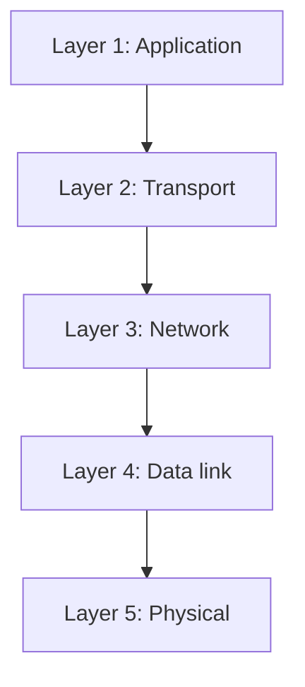
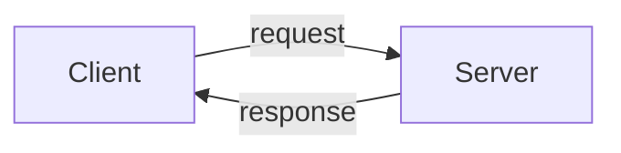
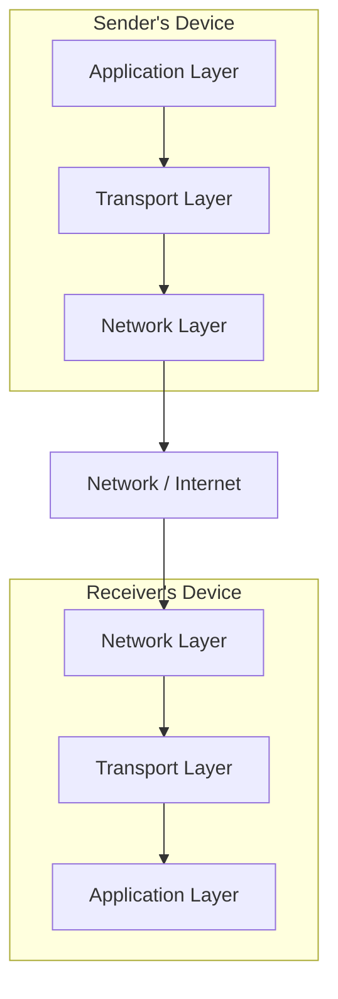
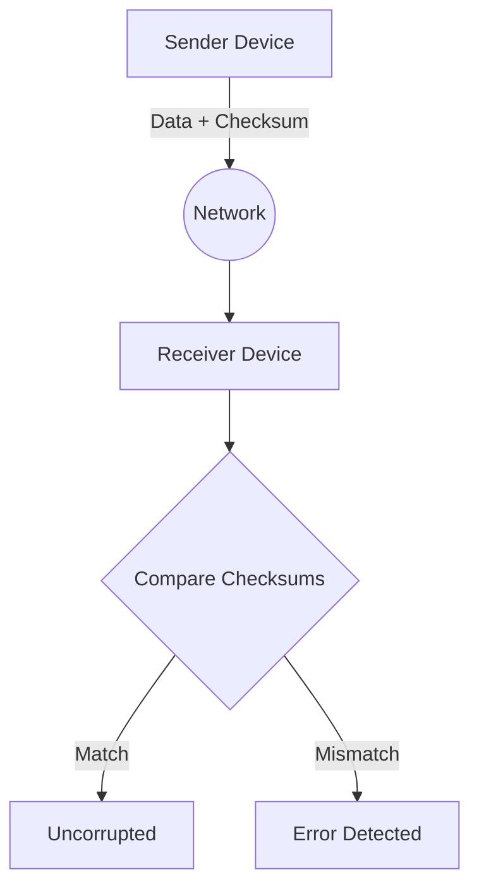
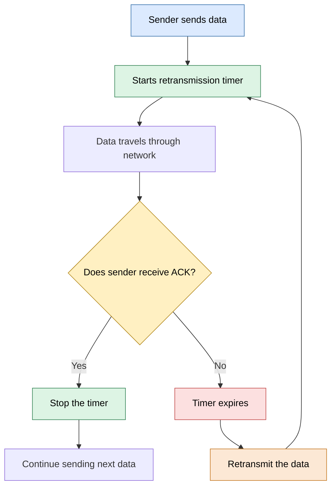
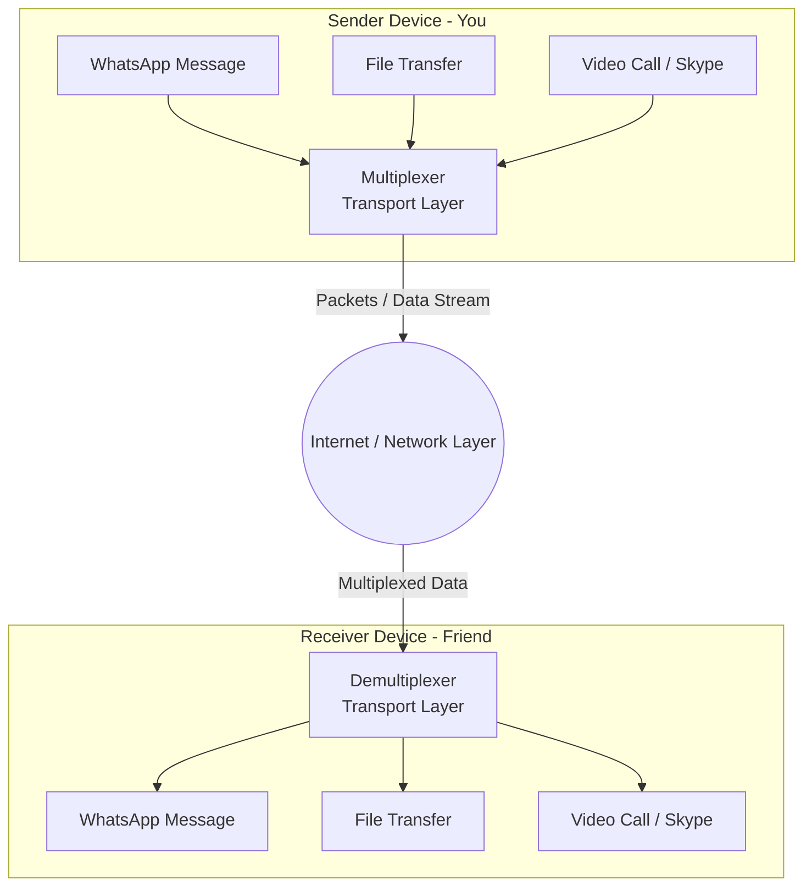

# TCP/IP Model

It contains only 5 layers 

TCP is used in,
• World Wide Web (HTTP/HTTPS)
• Email (SMTP, IMAP, POP3)
• File Transfers (FTP)

## Application Layer

This is where users mostly interact with it like using browser, texting in whatsapp etc .. which lies in our devices. HTTP is used in this layer

## Transport Layer
TCP and UDP are used in the Transport Layer. The Transport Layer passes data between the Application Layer and the Network Layer. It operates on the sender's and receiver's devices.

The Transport Layer uses source and destination port numbers to identify the sending and receiving applications. TCP provides reliable data delivery, while UDP provides connectionless communication without guaranteeing delivery. Transport layer takes care of congession (Traffic) control 

### Checksum 
A checksum is a value calculated from data and used to detect whether the data may have been corrupted during transmission.
While sending a data it is calculated using algorithm and after receiving the receiver's system also calculate the data using the same algorithm if a mismatch corrupted data if not uncorupted data

### Timers in the Transport Layer

Timers are used by TCP to manage reliable data transmission and detect when something goes wrong during communication.
TCP uses timers to avoid waiting forever when data or acknowledgements are not received.

## Multiplexing (Sender Side):

 When multiple applications (like a message, a file transfer, and a video call) send data simultaneously from your device, the transport layer combines and packages them to travel over a single network connection

## Demultiplexing (Receiver Side):

 When the data packets reach your friend's device, the transport layer separates (demultiplexes) the incoming stream using port numbers to ensure each piece of data is routed to the correct application

