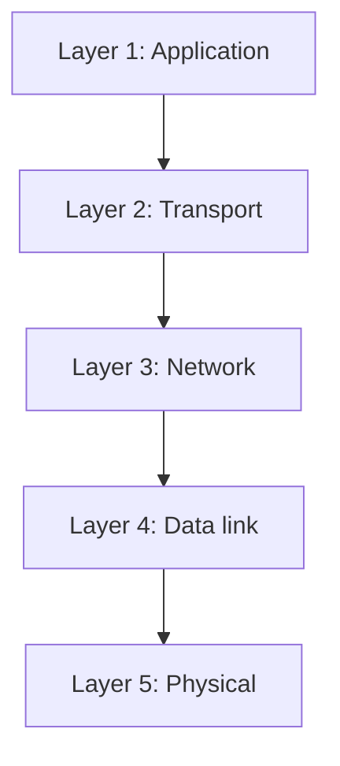
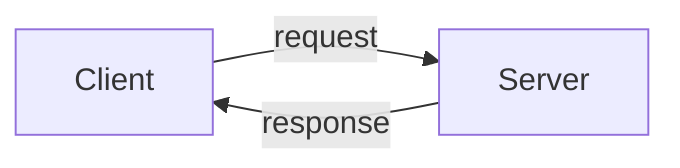
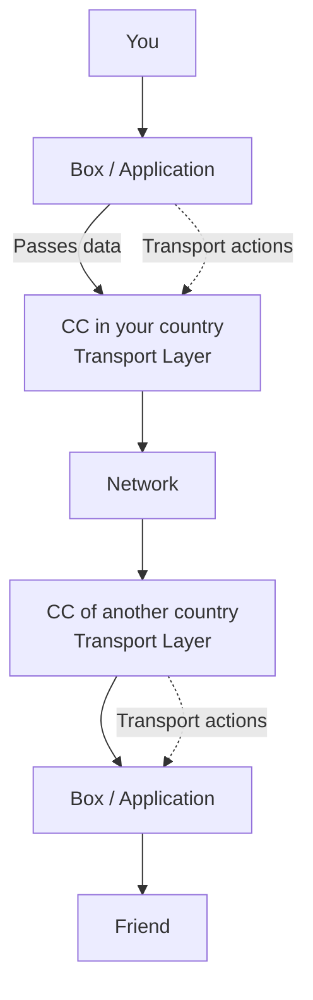

# TCP/IP Model

It contains only 5 layers 

TCP is used in,
• World Wide Web (HTTP/HTTPS)
• Email (SMTP, IMAP, POP3)
• File Transfers (FTP)

## Application Layer

This is where users mostly interact with it like using browser, texting in whatsapp etc .. which lies in our devices. HTTP is used in this layer

## Transport Layer

TCP is used in Transport layer. The Transport Layer passes data between the Application Layer and the network Layer.

