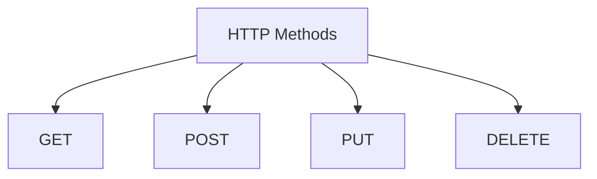

# HTTP Methods

## What is a HTTP Method?

A method is a process of telling the sever what to do. Its a stateless protocol.It is used in application layer

### * GET (READ)

Retrieves data from the server.

### * POST (CREATE)

Submits data to the server to create a new resource.

### * PUT (UPDATE)

Replaces an entire existing resource

### * DELETE (DELETE)

Removes a specific resource from the server

## Status codes

100 to 199: Informational Status Codes

200 to 299: Success Status Codes 

300 to 399: Redirection Status Codes

400 to 499: Client Error Status Codes

500 to 555: Server Error Status Codes