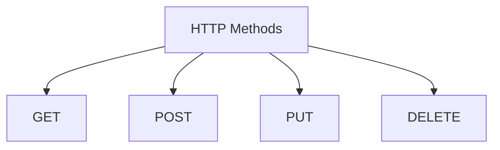

# HTTP Methods

## What is a HTTP Method?

A method is a process of telling the sever what to do

### GET (READ)

Retrieves data from the server.

### POST (CREATE)

Submits data to the server to create a new resource.

### PUT (UPDATE)

Replaces an entire existing resource

### DELETE (DELETE)

Removes a specific resource from the server