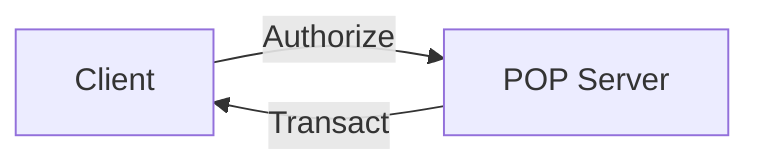
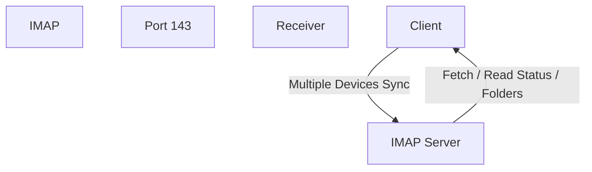

# SMTP

SMTP: Simple mail transfer protool

It is used to send mail to the people. It belongs to the application layer

# POP
The Post Office Protocol (POP), specifically its current version POP3, is a standard internet protocol used by email clients to download from a remote mail server over a TCP/IP connection.It uses the port 110

# IMAP

IMAP (Internet Message Access Protocol) is used to view the emails on multiple devices

