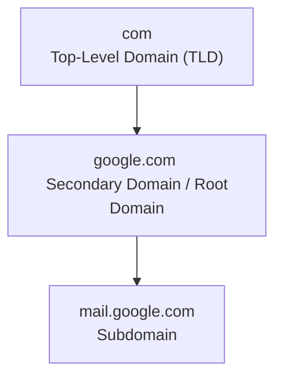

# DNS

Domian Name System

DNS is used to translate the Human Readable Domain names (eg:Google.com) into meachine readable IP Adresess

## Working of DNS

* User Input: The user enters a domain name (e.g., www.geeksforgeeks.org) in the browser.
* Local Cache Check: The browser or OS checks its cache for a stored IP address.
* DNS Resolver Query: If not found, the request is sent to a DNS resolver (usually by ISP).
* Root Server Query: The resolver queries a root server, which points to the correct TLD server.
* TLD Server Response: The TLD server directs the resolver to the domain’s authoritative server.
* Authoritative Server Response: The authoritative server returns the actual IP address.
* Final Response: The resolver sends the IP back to the user, and the browser connects to the server

```mermaid
graph TL
    A["1. User Input <br> Enter domain name (e.g., www.geeksforgeeks.org)"] --> B["2. Local Cache Check <br> Browser/OS checks cached IP address"]
    B --> C["3. DNS Resolver Query <br> Request sent to ISP's DNS resolver"]
    C --> D["4. Root Server Query <br> Resolver queries root server for TLD direction"]
    D --> E["5. TLD Server Response <br> TLD server directs to authoritative server"]
    E --> F["6. Authoritative Server Response <br> Authoritative server returns the actual IP address"]
    F --> G["7. Final Response <br> Resolver sends IP back, browser connects to server"]
```

# Sub Domain 

Sub domain is likely a part of the bigger domain 

eg:mail.google.com where,

* mail is a subdomain of google
* google is a secondary domain
* com is a top level domain


